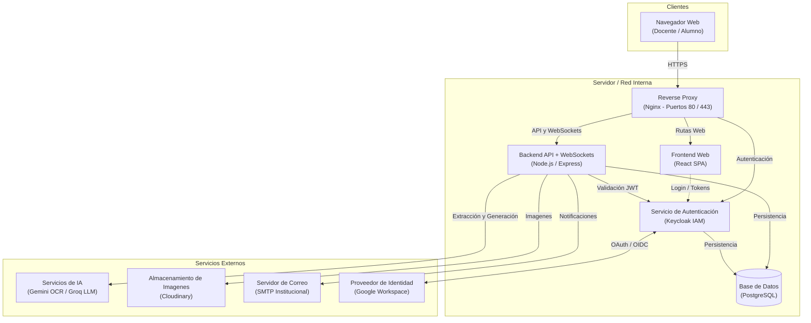
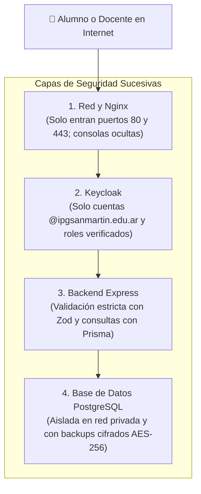

# Guía de Defensa de Tesis: Plataforma ERP Educativa Abacontex
**Proyecto de Tesis – Ingeniería en Sistemas de Información (UTN FRC)**  
**Equipo:** Araoz Noel, Bacci Fernández Nazarena, Españon Acevedo Braian Abel, Insfran Agustina Ayelén, Torazza Pacheco María Marta.

---

## 1. Arquitectura del Sistema

Abacontex adopta una arquitectura desacoplada basada en contenedores bajo un esquema **Monorepo**, garantizando independencia de componentes y portabilidad total.

### 1.1. Tecnologías por Capa
* **Frontend:** React 19, TypeScript, Vite, Tailwind CSS 4, TanStack Query (gestión de caché del servidor), React Hook Form + Zod (validación de formularios en cliente), Socket.IO Client (notificaciones en tiempo real) y React Markdown con Remark GFM. Servido mediante Nginx en contenedor Alpine con inyección de variables en tiempo de inicio (`docker-entrypoint.sh`).
* **Backend:** Node.js 22 (LTS), Express 5, TypeScript, Prisma ORM 7, PostgreSQL driver nativo (`@prisma/adapter-pg`), Socket.IO, Node-cron (schedulers) y Nodemailer.
* **Organización en Capas del Backend:**
  $$\text{Routes} \longrightarrow \text{Controller} \longrightarrow \text{Service} \longrightarrow \text{Repository} \longrightarrow \text{Prisma ORM} \longrightarrow \text{PostgreSQL}$$
  * *Routes:* Definen el pipeline HTTP, aplican middlewares de autenticación (`authMiddleware`), roles (`requireRole`) y validación de esquemas Zod.
  * *Controllers:* Delgados; reciben `req/res`, delegan al servicio y responden con el status HTTP y DTO correspondiente.
  * *Services:* Alojan el 100% de la lógica de negocio y las orquestaciones de dominio.
  * *Repositories:* Única capa autorizada para interactuar con Prisma y la base de datos.
  * *Stateless en Archivos:* Carga en memoria mediante `multer.memoryStorage()` y delegación directa por stream a Cloudinary (para imágenes de productos/empresas) o a Gemini (para extracción OCR), sin persistir archivos en el disco local del servidor.

---

## 2. Inteligencia Artificial: En el Proyecto y en el Desarrollo

Para defender la IA en Abacontex sin enredarse en tecnicismos de modelos, hay que tener claros **tres conceptos clave**: dónde se usa en la plataforma, por qué el motor contable NO usa IA, y cómo la usamos nosotros para programar.

### 2.1. Los 5 Casos de Uso en la Plataforma

| Función | Modelo en `.env` | Proveedor | ¿Para qué sirve? | Plan de Respaldo (Si falla) | Control y Seguridad |
|---|---|---|---|---|---|
| **1. Digitalización OCR** | `gemini-3.8-flash` *(en `GEMINI_OCR_MODELS`)* | **Google Gemini** | Lee fotos y PDFs de exámenes y los transcribe a tablas y texto Markdown. | **Cascada automática en código:** Si se satura (429/503), rota automáticamente a `3.7-flash`, `3.6-flash` o `flash-lite`. | **Cero datos personales:** Solo procesa consignas en blanco del examen, jamás hojas manuscritas de alumnos. |
| **2. Generación de Ejercicios** | `openai/gpt-oss-120b` *(en `GROQ_MODEL_GENERACION`)* | **Groq Cloud** | Crea enunciados contables a medida según el curso (5° SRL o 6° SA). | Si la API no responde, la interfaz captura el error y permite reintentar sin bloquear la plataforma. | **Reglas inyectadas en prompt:** Evita normativas contables inventadas. El docente puede editar el texto con el lápiz antes de crearlo. |
| **3. Ayuda de Devolución** | `openai/gpt-oss-120b` *(en `GROQ_MODEL_GENERACION`)* | **Groq Cloud** | Sugiere una respuesta orientativa con voseo argentino para corregir al alumno. | Si la API no responde, el docente redacta su devolución directamente a mano en el campo de texto. | **Human-in-the-Loop obligatorio:** La IA nunca envía nada directo al alumno; solo se habilita con $\ge 3$ errores. Cero datos personales enviados. |
| **4. Diagnóstico Semanal** | `openai/gpt-oss-120b` *(en `GROQ_MODEL_GENERACION`)* | **Groq Cloud** | Resume las dificultades grupales del curso para la planificación docente. | Reintento con parseo tolerante por regex si falla el formateador JSON en el borde de Groq. | **Umbral de significancia:** Solo se genera si hay $\ge 10$ errores acumulados, evitando alertas y análisis innecesarios. |
| **5. Simulación Empresarial** | `qwen/qwen3.8-27b` *(en `GROQ_MODEL_SIMULACION`)* | **Groq Cloud** | Crea el árbol de decisiones con consecuencias y roles ejecutivos. | **Reintentos automáticos con espera progresiva (5s y 10s)** ante fallas de la API + módulo de **auto-reparación de sintaxis JSON** (`repararJsonLlm`). | **Árbol precalculado:** Se genera una sola vez al inicio para jugar sin latencia ni costo por clic. El backend adapta las ramas por empresa sin gastar IA. |

---

### 💡 El Argumento Estrella: ¿Por qué el Motor de Corrección NO usa IA?
> [!IMPORTANT]
> **Cero Alucinación Contable:** Corregir si una cuenta contable está bien elegida o si el Debe iguala al Haber es matemática y normativa pura. Los modelos de lenguaje suelen fallar al sumar o razonar balances numéricos ("alucinaciones").  
> Por eso, la corrección de Abacontex la hace un **algoritmo determinista en TypeScript (< 20 milisegundos y costo \$0)**. La IA solo se usa para tareas de redacción y comprensión de texto, donde sí aporta valor pedagógico.

---

### 2.2. Metodología de Desarrollo Asistido por IA (Backend)
Para el desarrollo del backend, **Braian (desarrollador backend)** definió una metodología estricta para trabajar con asistentes de IA (Gemini, Cursor, Copilot). Para no perder el control del código ni desviar la arquitectura, la IA estuvo gobernada por dos documentos normativos: [`docs/prompt-ia.md`](prompt-ia.md) y [`docs/GuiaDesarrolloBackend.md`](GuiaDesarrolloBackend.md):

1. **Plan previo y Cero Suposiciones:** La IA tenía prohibido asumir reglas de negocio. Para cualquier cambio debía presentar primero un plan paso a paso y esperar un "OK" explícito antes de crear o editar archivos.
2. **Construcción capa por capa (sin atajos):** Obligación de respetar el orden estricto de la guía (`Validador Zod` $\rightarrow$ `Repositorio` $\rightarrow$ `Servicio` $\rightarrow$ `Controlador` $\rightarrow$ `Ruta`), sin saltearse capas ni mezclar lógica de negocio en los controladores.
3. **Supervisión incremental (un endpoint a la vez):** Prohibido trabajar en múltiples funciones en paralelo. Braian asignaba y supervisaba una única tarea concreta a la vez antes de avanzar a la siguiente.
4. **Terminal y entorno bloqueados:** La IA no podía ejecutar comandos de consola, migraciones de base de datos ni scripts sin autorización previa.
5. **Cero código predictivo o "TODOs":** Prohibido adelantarse a requerimientos futuros o dejar código especulativo; la IA debía limitarse exclusivamente a resolver el alcance pedido en el prompt.

---

## 3. Seguridad Informática y Privacidad de Datos

Para no complicarnos con tecnicismos innecesarios, la seguridad de Abacontex se puede explicar y defender fácilmente como un **sistema de capas (como una cebolla)**: para llegar a los datos sensibles, una petición tiene que superar 4 filtros sucesivos:

### 3.1. Primera Capa: Red y Perímetro (Lo que ve Internet)
* **Solo dos puertos abiertos:** En el servidor únicamente están abiertos los puertos web estándar **80** (HTTP, que redirige automáticamente a seguro) y **443** (HTTPS cifrado con SSL).
* **Acceso de administración cerrado (SSH):** El puerto 22 para entrar a la terminal del servidor **no está expuesto a Internet**. Para administrarlo nos conectamos mediante una red privada segura (**Tailscale / VPN**).
* **Consolas ocultas al público:** Las pantallas de administración de Keycloak (`/admin` y `/realms/master`) están bloqueadas para Internet. Si alguien intenta ingresar desde afuera, Nginx le devuelve un error como si la página no existiera (*404 Not Found*).

### 3.2. Segunda Capa: Identidad y Permisos (Keycloak)
* **Inicio de sesión centralizado:** Usamos **Keycloak** para gestionar usuarios y credenciales mediante tokens seguros (**JWT**). El backend no guarda contraseñas en su código ni en sus tablas principales.
* **Solo correos de la escuela:** Nadie con una cuenta personal de Gmail puede ingresar; una regla estricta exige pertenecer al dominio institucional (`@ipgsanmartin.edu.ar`).
* **Control de roles (RBAC):** El backend comprueba en cada llamada si el usuario es `ADMIN`, `DOCENTE` o `ALUMNO`. Un estudiante jamás puede ver las entregas de otro ni acceder a funciones docentes.

### 3.3. Tercera Capa: Seguridad en la Aplicación (Backend y Frontend)
* **Protección contra Inyección SQL:** Usamos **Prisma ORM**, que sanitiza y parametriza todas las consultas a la base de datos automáticamente (mitigando el riesgo clásico de inyección SQL).
* **Validación estricta con Zod:** Cada dato que llega desde el frontend (un formulario, un número, un texto) pasa por un esquema validador estricto. Si viene algo raro o campos de más, se rechaza antes de tocar la lógica del negocio.
* **Subida de archivos en memoria:** Las imágenes que se suben para el OCR o para fotos de productos se validan (máximo 10 MB y formatos permitidos) y se procesan en la memoria RAM temporal, sin guardarse nunca como archivos en el disco del servidor.

### 3.4. Cuarta Capa: Protección de Datos y Backups
* **Base de datos oculta:** PostgreSQL no tiene puertos expuestos a Internet; solo se comunica con el backend dentro de la **red interna privada** del servidor.
* **Secretos protegidos:** Las contraseñas y claves de API viven en un archivo `.env` fuera de Git y con permisos estrictos de lectura en el servidor (`chmod 600`).
* **Backups comprimidos y cifrados (AES-256):** Los respaldos nocturnos automáticos no solo se comprimen (`gzip`), sino que se pueden cifrar con una clave simétrica usando **OpenSSL** (`openssl enc -aes-256-cbc`). Si alguien llegara a tener acceso físico a los archivos de backup, no podrá leer nada sin la clave maestra.

### 3.5. Privacidad de Datos y Alumnos Menores (Ley 25.326)
Dado que los alumnos de escuelas secundarias son en su mayoría menores de edad, la plataforma incorpora cuatro defensas clave:

* **Anonimización algorítmica previa a la IA:** La IA nunca sabe a quién le está hablando. Para generar devoluciones pedagógicas ([`correccion-ia.service.ts`](../backend/src/integrations/correccion-ia/correccion-ia.service.ts)), el backend solo envía a Groq códigos abstractos contables (ej. `CUENTA_INCORRECTA: Caja`), **sin nombres, sin correos y sin notas**. Para el OCR de Gemini, solo se envían consignas en blanco de exámenes subidas por el docente, jamás hojas manuscritas de alumnos.
* **Minimización de Datos (Ley N° 25.326):** En la base de datos **no se guarda DNI, ni domicilio, ni teléfono, ni fecha de nacimiento**. Únicamente nombre, apellido y correo institucional verificado (`@ipgsanmartin.edu.ar`).
* **Cero Reentrenamiento de Modelos:** A diferencia de las webs públicas de ChatGPT o Gemini, el uso de APIs oficiales de desarrollador (Google y Groq) garantiza contractualmente que los datos no se usan para reentrenar modelos y se eliminan de la memoria de inferencia tras responder.
* **Trazabilidad Inmutable (Audit Log):** Con [`audit-log.service.ts`](../backend/src/services/audit-log.service.ts), cada cambio de nota, empresa o entrega queda registrado dentro de la misma transacción de base de datos con el usuario responsable (`performedById`), fecha y diferencia de valores (`oldValues` vs `newValues`), impidiendo adulteraciones o disputas sobre calificaciones.

---

### Resumen Visual: La Seguridad en 4 Pasos

---

## 4. Despliegue y Operación DevOps

### 4.1. Orquestación Contenerizada (`docker-compose.release.yml`)
El despliegue productivo consta de 5 microservicios desacoplados sobre una red privada virtual Docker (`abacontex-network`):
1. **`reverse-proxy` (Nginx Alpine):** Punto único de entrada exterior (puertos 80 y 443).
2. **`frontend` (Nginx Alpine):** Entrega de la SPA.
3. **`backend` (Node.js 22):** API REST y WebSockets.
4. **`keycloak` (Keycloak):** Servidor de identidad y control de acceso.
5. **`postgres` (PostgreSQL 17):** Persistencia compartida en dos esquemas/bases lógicas (`abacontex` e `keycloak`).

### 4.2. Estrategia de Ramas e Integración Continua (CI/CD)
* **Política de Ramas:**
  * `feature/*` / `fix/*`: Desarrollo de funcionalidades y correcciones.
  * `develop`: Integración técnica del equipo.
  * `test`: Entorno de validación y pruebas de QA.
  * `main`: Versión estable y etiquetada (`vX.Y.Z`).
* **Protección automatizada:** GitHub Actions (`validate-branch-flow.yml`) impide fusiones directas a `main`; solo `test` puede mergear a `main`, y solo `develop` a `test`.
* **Automatización CI/CD:**
  * En cada Pull Request se ejecutan pruebas automáticas, linters y compilación de TypeScript (`npm run check`).
  * Al publicar un tag de versión, GitHub Actions compila y sube automáticamente las imágenes oficiales a GitHub Container Registry (GHCR), listas para desplegarse en el servidor.

### 4.3. Arranque Automático y Dependencias por Salud
Para evitar errores de conexión (ej. que el backend intente operar sin base de datos o que el proxy devuelva error 502), el inicio de los contenedores está coordinado por chequeos de salud (*healthchecks*):
1. **PostgreSQL** inicia y valida que acepte conexiones.
2. **Backend** espera a la base de datos, ejecuta automáticamente las migraciones pendientes (`prisma migrate deploy`), carga las semillas del sistema (`prisma db seed`) e inicia el servidor.
3. **Reverse Proxy (Nginx)** espera a que el Backend responda con éxito en `/health` antes de comenzar a enrutar tráfico de usuarios.

### 4.4. Backups y Continuidad Operativa
* **Separación de bases en un solo motor:** Para no sobrecargar el servidor con dos instancias de base de datos, usamos un único motor PostgreSQL pero con dos bases lógicas independientes: `abacontex` (para la gestión del ERP: ventas, asientos, ejercicios) y `keycloak` (para usuarios y credenciales). Esto aísla la seguridad y ahorra memoria RAM.
* **Estrategia y script de respaldo (`scripts/backup.sh`):** Avanzamos con un script en Bash ya desarrollado y probado en el repo que hace el volcado en caliente (`pg_dump`) de ambas bases, las comprime y cifra con AES-256 (OpenSSL), y descarta automáticamente copias de más de 7 días para no saturar el almacenamiento.
* **Operativa pensada para producción:** La idea es que este script se programe para ejecutarse de forma desatendida todas las madrugadas (por ejemplo a las 02:00 AM mediante una tarea programada `cron` del servidor Linux). Con este esquema, ante cualquier caída o falla crítica de hardware, la pérdida máxima de datos sería de menos de un día y la restauración completa toma solo unos minutos restaurando el archivo SQL sobre los contenedores.

---

## 5. Costos Operativos y Análisis Financiero

Uno de los principales méritos de ingeniería de Abacontex es su **arquitectura de bajísimo costo operativo**, pensada para la realidad presupuestaria de instituciones educativas públicas o privadas subvencionadas:

| Componente | Tecnología / Proveedor | Estrategia de Costo | Costo Estimado Mensual |
|---|---|---|---|
| **Servidor Host** | VPS Linux (Azure / DigitalOcean / Hetzner / AWS) | 1 VM estándar (4 vCPUs, 8 GB RAM, 60 GB SSD) | \$15 - \$35 USD/mes *(o \$0 si se aloja en infraestructura propia de la universidad / colegio)* |
| **Base de Datos** | PostgreSQL | Open source, auto-alojado en contenedor (sin cargos de base administrada en la nube) | **\$0 USD** |
| **Identidad y Acceso** | Keycloak | Open source, auto-alojado en contenedor (sin licencias por usuario como Auth0 u Okta) | **\$0 USD** |
| **Almacenamiento de Imágenes** | Cloudinary CDN | Plan Gratuito (Free Tier): 25 créditos mensuales (~25.000 transformaciones o 25 GB de storage para fotos de productos, logos y avatares) | **\$0 USD** |
| **Correos Transaccionales** | SMTP Institucional | Servidor de correo propio de la institución educativa (`ipgsanmartin.edu.ar`) | **\$0 USD** |
| **Certificados SSL** | Let's Encrypt / Certbot | Certificados estándar gratuitos con renovación automática | **\$0 USD** |
| **OCR y Visión (IA)** | Google Gemini Flash | Costo por token multimodal ultra reducido. Para un volumen escolar de ~30 digitalizaciones de ejercicios/mes | **< \$0,05 USD/mes** |
| **LLM Generación / Feedback** | Groq Cloud API | Inferencia acelerada en LPU para modelos open-source (Llama 3 / Qwen) | **< \$2,00 USD/mes** |
| **TOTAL ESTIMADO** | — | — | **\$18 - \$38 USD/mes** |

> **💡 Clave de Argumentación para el Tribunal (Servidor Host):**  
> Si nos consultan cómo justificamos el costo del servidor host, la respuesta se fundamenta en el consumo real del stack: Keycloak (Quarkus/Java que demanda ~1.2 GB) y PostgreSQL marcan el piso operativo, requiriendo una máquina de **entre 4 y 8 GB de RAM**. En proveedores de excelente relación precio/rendimiento como Hetzner Cloud (~\$15 USD) o planes de 4 GB en DigitalOcean (\$24 USD), el rango de \$15 a \$35 USD/mes es 100% realista. Además, contamos con la alternativa ganadora: al estar completamente contenerizado con Docker Compose, si el colegio o la universidad dispone de un servidor o PC propia en su centro de cómputos, la plataforma se despliega a **costo \$0 USD**.

### Decisiones de Arquitectura para el Control de Costos:
1. **Motor Contable Determinista (Sin IA):** La detección de errores, el cálculo de aciertos y la verificación matemática corren en TypeScript en memoria (< 20 ms), consumiendo **cero tokens de IA**.
2. **Gobernanza y Reglas de Umbral para IA (analizadas en Sección 2):**
   * *Corrección individual:* El botón de sugerencia pedagógica con IA solo se habilita si la entrega del alumno tiene **$\ge 3$ errores**. Si tiene 0, 1 o 2 errores, son fallas puntuales que no justifican el costo de llamar a la API, ahorrando el 80% de llamadas innecesarias.
   * *Diagnóstico de curso:* El análisis global de dificultades del curso solo se genera si se acumulan **$\ge 10$ errores** y se verifica matemáticamente un cambio de tendencia real frente a la última medición.
3. **Simulaciones Precalculadas:** En el módulo de simulación empresarial, la IA genera el árbol de eventos y consecuencias en una única consulta inicial; durante la dinámica los alumnos toman decisiones navegando ese árbol sin invocar a la IA en cada clic.

### 5.1. Desglose de Consumo de IA: Simulación Mensual y Anual
Para dimensionar el costo real con precisión de ingeniería, se modeló una institución educativa tipo con **4 cursos de 30 alumnos (120 alumnos en total)** y **6 empresas simuladas por curso (24 empresas activas en total)** con equipos de 5 alumnos, durante un ciclo lectivo de 10 meses:

| Módulo con IA | Estimación de Uso Mensual | Tokens Promedio por Llamada | Costo Unitario | Costo Mensual Estimado |
|---|---|---|---|---|
| **Generación de Ejercicios** (Groq) | 32 ejercicios/mes *(8 por curso: 2 por semana)* | ~1.000 in / ~600 out | \$0.00106 USD | **\$0.034 USD** |
| **Digitalización OCR de Ejercicios** (Gemini Flash) | 32 digitalizaciones al mes *(8 por curso: 2 por semana)* | ~560 in / ~500 out | \$0.00019 USD | **\$0.006 USD** |
| **Retroalimentación Individual de Ejercicios** (Groq) | 96 sugerencias/mes *(solo entregas con $\ge 3$ errores)* | ~350 in / ~120 out | \$0.00010 USD | **\$0.010 USD** |
| **Diagnóstico Semanal de Curso** (Groq) | 16 diagnósticos/mes *(1 semanal por curso)* | ~600 in / ~250 out | \$0.00055 USD | **\$0.009 USD** |
| **Generación de Simulaciones** (Groq) | 16 simulaciones al mes *(1 por semana por curso; el backend adapta el árbol a cada empresa con `instanciarEstructuraParaEmpresa` sin consumir IA)* | ~1.500 in / ~2.500 out | \$0.00286 USD | **\$0.046 USD** |
| **Feedback Final de Simulación por Empresa** (Groq) | 96 devoluciones al mes *(1 evaluación final con IA por simulación semanal para cada una de las 24 empresas)* | ~500 in / ~250 out | \$0.00049 USD | **\$0.047 USD** |
| **Toma de decisiones de alumnos durante la simulación** | Recorrido interactivo de los árboles precalculados | — | **\$0.00 USD** | **\$0.00 USD** |
| **TOTAL MENSUAL IA (Pay-As-You-Go)** | — | — | — | **~\$0.152 USD/mes** |
| **TOTAL ANUAL IA (10 meses lectivos)** | — | — | — | **~\$1.52 a \$2.00 USD/año** |

#### ¿Es viable operar con los Planes Gratuitos (Free Tier)?
* **Totalmente viable:** Una institución con 24 empresas y 4 cursos realiza apenas unas **6 a 10 llamadas diarias** a servicios de IA distribuidas a lo largo del mes.
  * **Google Gemini:** Permite **1.500 peticiones diarias** gratuitas (el colegio consume apenas el 0.1% del cupo diario).
  * **Groq Cloud:** Permite **14.400 peticiones diarias** gratuitas (el colegio consume menos del 0.05% del cupo).
  * **Cloudinary:** Permite **25.000 operaciones mensuales** gratuitas para imágenes (el colegio sube unas pocas decenas al mes para productos y logos).
* **Conclusión para la defensa:** La plataforma puede operar **al 100% en planes gratuitos** sin costo alguno para la escuela. Si la institución optara por pagar bajo modalidad *Pay-As-You-Go* para garantizar acuerdos de nivel de servicio (SLA) y contratos de no reentrenamiento, el costo de IA para todo el año escolar rondaría entre **\$1 y \$2 USD**.

### 5.2. Cloudinary y Dominio (Decisiones Clave)
* **¿Por qué no pagar Cloudinary?** Su plan pago cuesta \$90+ USD/mes y es innecesario: solo guardamos fotos de productos, logos y avatares (< 1 GB al año, usamos menos del 2% del plan gratuito). Si a futuro creciera la demanda, el backend desacoplado (`storage.service.ts`) permite migrar a almacenamiento S3 (Cloudflare R2 o AWS S3) por centavos de dólar.
* **Alternativas de Dominio (DNS):**
  * *Subdominio institucional (.edu.ar) – Recomendada:* Delegar `abacontex.ipgsanmartin.edu.ar` sobre el dominio existente del colegio $\rightarrow$ **\$0 USD**.
  * *FQDN gratuito de la nube:* Usar el dominio provisto por Azure (`abacontex...cloudapp.azure.com`) $\rightarrow$ **\$0 USD**.
  * *Dominio propio comercial:* Un `.com.ar` en NIC Argentina cuesta ~\$10 a \$15 USD al año (~\$1 USD/mes).

---

## 6. Banco de Preguntas y Respuestas para el Tribunal (Q&A)

### P1: "¿Por qué eligieron una arquitectura Monorepo en lugar de repositorios separados para frontend y backend?"
**Respuesta:**  
"Elegimos un Monorepo porque nos permitió mantener sincronizados en un único historial de versiones los contratos de datos (DTOs y validadores Zod), la documentación técnica de arquitectura (ADRs y guías) y la configuración de infraestructura de Docker Compose. Para un equipo de 5 ingenieros agiliza notablemente los Pull Requests, previene desfasajes de versión entre cliente y servidor, y simplifica la orquestación de CI/CD en GitHub Actions sin la sobrecarga de coordinar múltiples repositorios independientes."

---

### P2: "¿Por qué no utilizaron un modelo de IA local como Ollama en lugar de APIs en la nube?"
**Respuesta:**  
"Por restricciones de hardware y costos de infraestructura en el servidor host. Ejecutar modelos locales de visión multimodal (como LLaVA para OCR) y LLMs de razonamiento (como Llama 3 70B) requeriría servidores con GPUs dedicadas de al menos 16 a 24 GB de VRAM, disparando los costos de hosting a más de \$150 USD mensuales. Utilizando Gemini Flash y Groq en la nube, operamos con costos de apenas unos centavos por llamada, tiempos de respuesta de entre 1 y 3 segundos y permitimos que el servidor de producción corra perfectamente en una máquina virtual modesta de 8 GB de RAM sin GPU."

---

### P3: "¿Qué sucede si se cae el servicio de Gemini o se agota la cuota en pleno examen escolar?"
**Respuesta:**  
"El sistema fue diseñado con alta resiliencia y desacoplamiento:
1. En el backend implementamos un patrón de fallback en cascada con `GEMINI_OCR_MODELS`: si `gemini-3.8-flash` se satura, el servicio reintenta automáticamente con `gemini-3.7-flash`, `gemini-3.6-flash` o `flash-lite`.
2. Si todas las APIs externas fallaran, el sistema contable **no se bloquea en ningún momento**. La carga manual de enunciados, la resolución de ejercicios en el ERP y la corrección mediante el motor determinista siguen funcionando al 100%, porque el núcleo del sistema no depende de la IA para operar."

---

### P4: "¿Por qué implementaron Keycloak en vez de autenticación simple con JWT generados por el backend en Express?"
**Respuesta:**  
"Por estándares de la industria, seguridad y separación de responsabilidades. Keycloak nos brinda una solución de IAM de grado empresarial que soporta OpenID Connect, OAuth 2.0, rotación de claves públicas mediante JWKS, políticas de bloqueo de contraseñas y federación de identidades con Google Workspace institucional. Dejar la gestión de contraseñas, hashing y tokens en un componente especializado reduce drásticamente el riesgo de vulnerabilidades criptográficas en el backend y permite que la API de Express permanezca completamente stateless."

---

### P5: "¿Cómo garantizan que un alumno no pueda ver las soluciones de los ejercicios inspeccionando las llamadas de red en el navegador?"
**Respuesta:**  
"La solución modelo del docente se almacena en la tabla `ejercicios_plantillas` y **nunca se envía al cliente frontend en los endpoints del alumno**. Cuando el alumno consulta el ejercicio (`GET /ejercicios/:id`), el backend utiliza un DTO específico (`EjercicioAlumnoResponseDto`) que omite deliberadamente el campo `contenido` de la solución modelo. La comparación entre lo que entregó el alumno y la solución se ejecuta exclusivamente en el backend dentro del servicio de corrección docente."

---

### P6: "¿Cómo aseguran que el motor de base de datos no sufra inconsistencias ante la concurrencia de alumnos entregando al mismo tiempo?"
**Respuesta:**  
"Implementamos transacciones atómicas a través del cliente de Prisma ORM (`prisma.$transaction`), asegurando que la cabecera de la entrega y las resoluciones de cada plantilla se persistan bajo el principio ACID (todo o nada). Además, para la base de datos PostgreSQL utilizamos un pool de conexiones optimizado y en Keycloak desacoplamos el almacenamiento en una base dedicada (`keycloak`), evitando contención de bloqueos entre las sesiones de autenticación y las tablas transaccionales del ERP."

---

### P7: "¿Qué medidas tomaron respecto a la privacidad de datos de los estudiantes menores de edad (Ley 25.326 / RGPD)?"
**Respuesta:**  
"Implementamos cuatro defensas estructurales:
1. **Anonimización algorítmica ante la IA:** Groq y Gemini jamás reciben el nombre, correo ni datos de ningún alumno; la retroalimentación se consulta enviando únicamente códigos abstractos de error contable y el OCR solo procesa consignas en blanco de exámenes.
2. **Minimización de datos (Ley 25.326):** En la base de datos no se almacena DNI, ni teléfonos, ni domicilios; solo nombre, apellido y correo institucional verificado (`@ipgsanmartin.edu.ar`).
3. **Cero reentrenamiento:** Operamos mediante APIs de desarrollador que garantizan por contrato que el tráfico no se utiliza para entrenar modelos públicos de IA.
4. **Trazabilidad inmutable:** Implementamos un Audit Log transaccional (`audit-log.service.ts`) que registra quién modificó cada nota o entrega con su historial de cambios, garantizando no-repudio."

---

### P8: "¿Por qué el backend es stateless si se suben archivos como imágenes y exámenes para OCR?"
**Respuesta:**  
"Para facilitar la escalabilidad horizontal y evitar depender de volúmenes persistentes atados a un servidor específico. Al recibir un archivo con Multer, este se almacena temporalmente en la memoria RAM del proceso (`multer.memoryStorage()`) y se delega de inmediato mediante streams: las imágenes fijas de productos y empresas se suben a Cloudinary CDN, mientras que las fotos de exámenes para OCR se envían a la API de Gemini. Una vez finalizada la petición, el buffer en memoria se libera en el Garbage Collector de Node.js, manteniendo el contenedor backend completamente libre de almacenamiento de archivos en disco."
