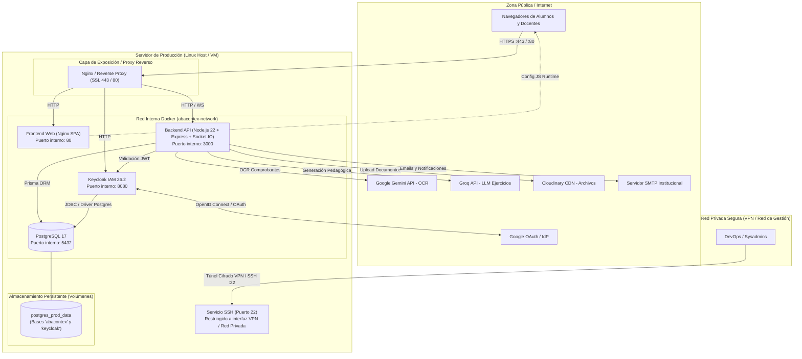

# MANUAL DE INSTALACIÓN Y OPERACIÓN
## Plataforma ERP Educativa — Abacontex

| Ficha Técnica | Detalle |
|---|---|
| **Sistema** | Abacontex — Plataforma ERP Educativa |
| **Documento** | Manual de Instalación y Operación en Producción |
| **Para qué** | Permite instalar / desplegar, configurar y operar el sistema en producción sin intervención del equipo de desarrollo. |
| **Para quién** | Administradores de Sistemas, Ingenieros DevOps y futuros mantenedores de infraestructura. |
| **Versión del Manual** | 1.0.0 |
| **Fecha de emisión** | Noviembre 2026 |

---

## Índice de Contenidos

1. [Arquitectura General del Despliegue](#1-arquitectura-general-del-despliegue)
2. [Requisitos de Hardware y Software](#2-requisitos-de-hardware-y-software)
   - 2.1. [Requisitos de Hardware](#21-requisitos-de-hardware)
   - 2.2. [Requisitos de Software del Servidor](#22-requisitos-de-software-del-servidor)
   - 2.3. [Requisitos de Red, Dominios y Puertos](#23-requisitos-de-red-dominios-y-puertos)
   - 2.4. [Dependencias y Cuentas de Servicios Externos](#24-dependencias-y-cuentas-de-servicios-externos)
3. [Configuración de Variables de Entorno y Secretos](#3-configuración-de-variables-de-entorno-y-secretos)
   - 3.1. [Estructura del archivo `.env`](#31-estructura-del-archivo-env)
   - 3.2. [Matriz detallada de variables](#32-matriz-detallada-de-variables)
   - 3.3. [Generación segura de contraseñas y secretos](#33-generación-segura-de-contraseñas-y-secretos)
   - 3.4. [Seguridad y permisos de archivos de configuración](#34-seguridad-y-permisos-de-archivos-de-configuración)
4. [Procedimiento de Instalación y Despliegue Paso a Paso](#4-procedimiento-de-instalación-y-despliegue-paso-a-paso)
   - 4.1. [Paso 1: Preparación del Servidor Host](#41-paso-1-preparación-del-servidor-host)
   - 4.2. [Paso 2: Obtención de los Artefactos de Despliegue](#42-paso-2-obtención-de-los-artefactos-de-despliegue)
   - 4.3. [Paso 3: Creación y Parametrización del Archivo `.env`](#43-paso-3-creación-y-parametrización-del-archivo-env)
   - 4.4. [Paso 4: Descarga de Imágenes Oficiales (Pull GHCR)](#44-paso-4-descarga-de-imágenes-oficiales-pull-ghcr)
   - 4.5. [Paso 5: Despliegue e Inicialización de Contenedores](#45-paso-5-despliegue-e-inicialización-de-contenedores)
   - 4.6. [Paso 6: Configuración del Reverse Proxy y Certificados SSL/TLS](#46-paso-6-configuración-del-reverse-proxy-y-certificados-ssltls)
   - 4.7. [Paso 7: Verificación del Despliegue (Smoke Testing)](#47-paso-7-verificación-del-despliegue-smoke-testing)
5. [Gestión de Backups y Plan de Restauración (Disaster Recovery)](#5-gestión-de-backups-y-plan-de-restauración-disaster-recovery)
   - 5.1. [Estrategia y Política de Respaldos](#51-estrategia-y-política-de-respaldos)
   - 5.2. [Procedimiento de Respaldo de Base de Datos PostgreSQL](#52-procedimiento-de-respaldo-de-base-de-datos-postgresql)
   - 5.3. [Automatización con Cron en el Host](#53-automatización-con-cron-en-el-host)
   - 5.4. [Respaldo de Archivos de Configuración y Secretos](#54-respaldo-de-archivos-de-configuración-y-secretos)
   - 5.5. [Procedimiento de Restauración Paso a Paso](#55-procedimiento-de-restauración-paso-a-paso)
6. [Monitoreo, Operación Continua y Mantenimiento](#6-monitoreo-operación-continua-y-mantenimiento)
   - 6.1. [Endpoints y Chequeos de Salud (Healthchecks)](#61-endpoints-y-chequeos-de-salud-healthchecks)
   - 6.2. [Gestión y Rotación de Logs de Contenedores](#62-gestión-y-rotación-de-logs-de-contenedores)
   - 6.3. [Monitoreo de Recursos y Métricas](#63-monitoreo-de-recursos-y-métricas)
   - 6.4. [Tareas Programadas Internas (Schedulers)](#64-tareas-programadas-internas-schedulers)
   - 6.5. [Procedimiento de Actualización de Versión (Upgrade / Rollback)](#65-procedimiento-de-actualización-de-versión-upgrade--rollback)
   - 6.6. [Resolución de Incidentes Frecuentes (Troubleshooting)](#66-resolución-de-incidentes-frecuentes-troubleshooting)
7. [Checklist de Puesta en Producción](#7-checklist-de-puesta-en-producción)

---

## 1. Arquitectura General del Despliegue

La plataforma **Abacontex** está diseñada bajo un modelo de microservicios contenerizados desacoplados que se orquestan mediante **Docker Compose**:



### Componentes del Sistema:

1. **Frontend (`abacontex-frontend-prod`)**: Aplicación Single Page Application (SPA) en React + TypeScript servida por Nginx Alpine. La configuración de variables de entorno públicas se inyecta dinámicamente en tiempo de inicio mediante `docker-entrypoint.sh` y `envsubst`.
2. **Backend API (`abacontex-backend-prod`)**: Servidor API RESTful y WebSockets (Socket.IO) sobre Node.js 22, Express y Prisma ORM. En su arranque (`entrypoint.release.sh`) ejecuta automáticamente migraciones de base de datos (`prisma migrate deploy`) y semillas de datos del sistema (`prisma db seed`). Su arquitectura es **completamente stateless (sin estado en disco)**: las cargas de comprobantes y documentos contables se procesan en memoria (`multer.memoryStorage()`) y se delegan directamente a Cloudinary, por lo que el contenedor no requiere volúmenes persistentes de almacenamiento para archivos multimedia.
3. **IAM / Autenticación (`abacontex-keycloak-prod`)**: Servidor Keycloak 26.2 encargado del control de acceso basado en roles (RBAC) y federación de identidades mediante Google Workspace (restringido al dominio institucional `ipgsanmartin.edu.ar`). Opera desacoplado y sin almacenamiento local de base de datos H2: persiste todas sus identidades, credenciales, sesiones y eventos en PostgreSQL en su propia base `keycloak`.
4. **Base de Datos (`abacontex-postgres-prod`)**: Motor relacional PostgreSQL 17 optimizado con inicialización automatizada (`01-init-keycloak-db.sql`), volumen persistente dedicado y healthchecks nativos. Centraliza la totalidad de los datos del ecosistema en dos bases independientes: `abacontex` (ERP) y `keycloak` (IAM).

---

## 2. Requisitos de Hardware y Software

### 2.1. Requisitos de Hardware

Los requerimientos de hardware dependen de la concurrencia de alumnos, cursos simultáneos y volumen de procesamiento contable y de IA.

| Recurso | Requisito Mínimo (Pruebas / Staging) | Requisito Recomendado (Producción Institucional) |
|---|---|---|
| **Procesador (CPU)** | 2 vCPUs (x86_64 o ARM64) | 4 vCPUs o superior |
| **Memoria RAM** | 4 GB | 8 GB o superior |
| **Almacenamiento** | 25 GB SSD | 60+ GB SSD (NVMe recomendado) |
| **Ancho de banda** | 20 Mbps simétrico | 100 Mbps simétrico |
| **Distribución de RAM estimada** | Keycloak: ~1.5 GB<br/>PostgreSQL: ~512 MB - 1 GB<br/>Backend Node: ~512 MB<br/>Frontend Nginx: ~64 MB<br/>SO / Buffer: ~1 GB | Asegura holgura para picos de conexión de Socket.IO y procesamiento de comprobantes contables. |

> [!IMPORTANT]
> Keycloak opera sobre una máquina virtual Java (Quarkus runtime) y requiere al menos 1.2 GB de memoria RAM garantizada para arrancar e importar realms sin activar el OOM Killer del sistema operativo. Se recomienda configurar swap de al menos 2 GB en el host si se dispone de 4 GB de RAM.

### 2.2. Requisitos de Software del Servidor

- **Sistema Operativo**: Distribución Linux para servidores de 64 bits con soporte a largo plazo (LTS).
  - Recomendado: **Ubuntu Server 22.04 LTS** o **Ubuntu Server 24.04 LTS**.
  - Alternativas compatibles: Debian 12 (Bookworm), RHEL 9, Rocky Linux 9.
- **Docker Engine**: Versión **24.0.0** o superior.
- **Docker Compose**: Plugin Compose **v2.20.0** o superior (comando nativo `docker compose`).
- **Git**: Versión 2.30 o superior (para clonar/actualizar plantillas de despliegue).
- **Utilidades auxiliares del host**: `curl`, `tar`, `gzip`, `openssl`, `cron` / `systemd-timers`.

### 2.3. Requisitos de Red, Dominios y Puertos

#### Dominios y DNS requeridos
Para un despliegue en producción con SSL/TLS, la arquitectura soporta de forma nativa dos modelos de resolución:

1. **Modelo Unificado por Rutas (Recomendado para servidores individuales / FQDN Cloud como Azure):**
   Un único nombre de dominio centraliza todos los servicios bajo el mismo origen HTTPS, eliminando problemas de CORS entre dominios y simplificando la gestión de certificados a un único archivo SSL:
   - **Plataforma Integral**: `https://abacontex.institucion.edu.ar` (o FQDN provisto por el proveedor cloud, ej. `abacontex.region.cloudapp.azure.com`).
   - Rutas enrutadas internamente: `/` (Frontend), `/api/` (Backend), `/socket.io/` (WebSockets) y `/realms/` (Keycloak IAM).

2. **Modelo por Subdominios Dedicados (Arquitectura Enterprise):**
   Si la institución delega su propia zona DNS y prefiere separar las fronteras de origen:
   - **Frontend / Portal**: `https://abacontex.institucion.edu.ar`
   - **Backend API**: `https://api.abacontex.institucion.edu.ar`
   - **Keycloak IAM**: `https://auth.abacontex.institucion.edu.ar`

*Ambos modelos se encuentran preconfigurados en el Reverse Proxy Nginx ([`proxy/conf.d/default.conf`](../proxy/conf.d/default.conf)).*

#### Matriz de Puertos

| Puerto | Protocolo | Exposición | Propósito |
|---|---|---|---|
| **80** | TCP | Público | Redirección obligatoria HTTP a HTTPS. |
| **443** | TCP | Público | Tráfico HTTPS cifrado hacia el Reverse Proxy. |
| **3000** | TCP | Interno / Docker | API Backend de Abacontex (comunicación interna dentro de la red Docker). |
| **8080** | TCP | Interno / Docker | Interfaz de Keycloak (comunicación interna dentro de la red Docker). Solo accesible a través del Reverse Proxy. |
| **5432** | TCP | **Privado / Loopback (`127.0.0.1`)** | PostgreSQL. Enlazado exclusivamente a la interfaz local (`127.0.0.1:5432`) para administración y auditorías seguras mediante túneles SSH. Bloqueado para internet público. |
| **22** | TCP | **Privado / Red de Gestión (VPN)** | Acceso SSH administrativo restringido a una red privada o VPN de gestión (ej. Tailscale, WireGuard o red interna de administración). El puerto 22 debe encontrarse **completamente bloqueado en el firewall perimetral (Security Group de la nube o firewall perimetral)** hacia Internet público, reduciendo la superficie pública de ataque estrictamente a los puertos web 80 y 443. |

#### Conectividad de Salida (Egress Firewall)
El servidor debe permitir conexiones salientes por los siguientes puertos:
- **TCP 443 (HTTPS)**: Requerido para descarga de imágenes desde GitHub Container Registry (`ghcr.io`), autenticación con Google OAuth (`accounts.google.com`), APIs de Google Gemini (`generativelanguage.googleapis.com`), Groq API (`api.groq.com`) y Cloudinary (`api.cloudinary.com`).
- **TCP 587 o 465**: Hacia el servidor SMTP institucional para el envío de notificaciones y correos.

### 2.4. Dependencias y Cuentas de Servicios Externos

Antes de iniciar el despliegue, el administrador debe asegurarse de contar con las siguientes credenciales:
1. **Google Cloud Console**: Proyecto configurado con OAuth 2.0 Web Application credentials.
   - Redirect URI autorizado: `https://<KEYCLOAK_HOSTNAME>/realms/abacontex/broker/google/endpoint`
   - Restricción de dominio: Configurado para permitir únicamente cuentas del dominio educativo asignado (ej. `ipgsanmartin.edu.ar`).

> [!NOTE]
> **Validación de correos en el Realm de Keycloak:** El archivo [`keycloak/realm-export.prod.json`](../keycloak/realm-export.prod.json) incluye una validación de formato mediante expresión regular en el perfil de usuario (`^[A-Za-z0-9._%+-]+@ipgsanmartin\.edu\.ar$`). Si se despliega para otra institución o dominio, debe actualizarse este patrón en la consola administrativa de Keycloak (*Realm Settings > User Profile > email > Validations > pattern*) o en el archivo JSON antes de la importación inicial.
2. **Google Gemini API**: API Key para el servicio de OCR y extracción documental contable.
3. **Groq Cloud API**: API Key con acceso a modelos Llama 3 / open-source (`openai/gpt-oss-120b`) para la generación didáctica de casos prácticos.
4. **Cloudinary**: Cuenta corporativa para persistencia de activos multimedia (Cloud Name, API Key, API Secret).
5. **Servidor SMTP**: Servidor de correo de la institución con credenciales de envío válidas.

---

## 3. Configuración de Variables de Entorno y Secretos

El sistema lee su configuración desde un archivo `.env` ubicado en la raíz del directorio de despliegue.

### 3.1. Estructura del archivo `.env`

El repositorio incluye un archivo modelo [`.env.example`](../.env.example) que sirve de base para el entorno productivo.

### 3.2. Matriz detallada de variables

A continuación se detallan todas las variables agrupadas por subsistema:

#### 1. Base de Datos (PostgreSQL)

| Variable | Tipo | Ejemplo en Producción | Descripción |
|---|---|---|---|
| `POSTGRES_DB` | Texto | `abacontex` | Nombre de la base de datos relacional. |
| `POSTGRES_USER` | Texto | `abacontex_admin` | Usuario propietario de la base de datos. Evitar usar `postgres`. |
| `POSTGRES_PASSWORD` | Secreto | `Xk9#mP2$vL90@qZ!` | Contraseña robusta del usuario de PostgreSQL. |
| `DATABASE_URL_DOCKER` | Cadena | `postgresql://abacontex_admin:Xk9#mP2$vL90@qZ!@postgres:5432/abacontex?schema=public` | URL de conexión JDBC/Prisma utilizada por el contenedor backend para conectarse al contenedor `postgres`. |
| `POSTGRES_PORT` | Número | `5432` | Puerto en el host (se aconseja mantener `127.0.0.1:5432` o no enlazar a interfaz pública). |

#### 2. Keycloak (Gestor de Identidades y Accesos)

| Variable | Tipo | Ejemplo en Producción | Descripción |
|---|---|---|---|
| `KEYCLOAK_DB` | Texto | `keycloak` | Nombre de la base de datos relacional exclusiva para Keycloak dentro de PostgreSQL. |
| `KEYCLOAK_ADMIN_USER` | Texto | `kcadmin` | Usuario administrador raíz de la consola Keycloak. |
| `KEYCLOAK_ADMIN_PASSWORD` | Secreto | `Sup3rS3cur3_Admin2026!` | Contraseña maestra del administrador de Keycloak. |
| `KEYCLOAK_HOSTNAME` | Dominio | `auth.abacontex.institucion.edu.ar` | Nombre de dominio completamente calificado (FQDN) público por el cual los clientes acceden a Keycloak. |
| `KEYCLOAK_PORT` | Número | `8080` | Puerto interno mapeado al host. |
| `GOOGLE_CLIENT_ID` | Secreto | `123456789-abc.apps.googleusercontent.com` | ID de cliente OAuth 2.0 de Google. |
| `GOOGLE_CLIENT_SECRET` | Secreto | `GOCSPX-xxxxxxxxxxxxxx` | Clave secreta del cliente OAuth de Google. |
| `GOOGLE_HOSTED_DOMAIN` | Dominio | `ipgsanmartin.edu.ar` | Restringe el inicio de sesión a correos con este dominio educativo. |

#### 3. Backend API y Servicios Externos

| Variable | Tipo | Ejemplo en Producción | Descripción |
|---|---|---|---|
| `BACKEND_PORT` | Número | `3000` | Puerto en el host donde escucha la API Express. |
| `ENVIRONMENT` / `VITE_ENVIRONMENT` | Enum | `production` | Entorno de ejecución (`production`). Deshabilita Swagger/Scalar público y ejecuta únicamente seeds de sistema (`systemSeeds`), omitiendo datos demo. |
| `FRONTEND_URL` | URL | `https://abacontex.institucion.edu.ar` | URL base del frontend para emisión de links y configuración de CORS. |
| `KEYCLOAK_REALM` | Texto | `abacontex` | Nombre del Realm configurado en Keycloak. |
| `KEYCLOAK_BASE_URL` | URL | `http://keycloak:8080` | URL de resolución interna dentro de la red Docker entre Backend y Keycloak. |
| `KEYCLOAK_ISSUER` | URL | `https://auth.abacontex.institucion.edu.ar/realms/abacontex` | Emisor del token JWT esperado para validar firmas de autenticación. |
| `KEYCLOAK_ADMIN_CLIENT_ID` | Texto | `backend-api` | Identificador del cliente confidencial de Keycloak utilizado por el backend para gestión de usuarios. |
| `KEYCLOAK_ADMIN_CLIENT_SECRET` | Secreto | `secret-del-cliente-keycloak` | Secreto del cliente `backend-api` generado en Keycloak. |
| `KEYCLOAK_FRONTEND_CLIENT_ID` | Texto | `frontend` | ID del cliente público de la SPA. |
| `KEYCLOAK_TESTING_CLIENT_ID` | Texto | `testing` | ID del cliente para suites de pruebas automatizadas. |
| `SMTP_HOST` | Host | `smtp.institucion.edu.ar` | Host del servidor SMTP para notificaciones. |
| `SMTP_PORT` | Número | `587` | Puerto SMTP (587 STARTTLS o 465 SSL). |
| `SMTP_SECURE` | Booleano | `false` | `true` si usa SSL en puerto 465; `false` si usa STARTTLS en puerto 587. |
| `SMTP_USER` | Texto | `notificaciones@institucion.edu.ar` | Usuario de autenticación SMTP. |
| `SMTP_PASSWORD` | Secreto | `ContraseñaSMTP2026` | Contraseña del correo emisor. |
| `SMTP_FROM` | Email | `no-reply@institucion.edu.ar` | Dirección de remitente que verán los usuarios. |
| `SMTP_FROM_NAME` | Texto | `Abacontex ERP Educativo` | Nombre legible del remitente. |
| `CLOUDINARY_CLOUD_NAME` | Texto | `abacontex-cloud` | Cloud Name asignado en la consola de Cloudinary. |
| `CLOUDINARY_API_KEY` | Secreto | `987654321098765` | API Key de Cloudinary. |
| `CLOUDINARY_API_SECRET` | Secreto | `CloudinarySecretKey123` | API Secret de Cloudinary. |
| `GEMINI_API_KEY` | Secreto | `AIzaSyBxxxxxxx-xxxxxxx` | API Key de Google AI Studio / Google Cloud Vertex AI. |
| `GEMINI_OCR_MODELS` | Lista | `gemini-3.8-flash,gemini-3.7-flash,gemini-3.6-flash,gemini-3.7-flash-lite` | Lista en orden de fallback para el OCR contable. |
| `OCR_MAX_FILE_SIZE_MB` | Número | `10` | Límite máximo en Megabytes para comprobantes subidos (10 MB). |
| `OCR_MOCK_ENABLED` | Booleano | `false` | `false` en producción (fuerza uso de IA real). |
| `GROQ_API_KEY` | Secreto | `gsk_xxxxxxxxxxxxxxx` | API Key para la plataforma Groq. |
| `GROQ_MODEL_GENERACION` | Texto | `openai/gpt-oss-120b` | Identificador del modelo para generación de ejercicios didácticos. |

#### 4. Frontend Web (SPA)

| Variable | Tipo | Ejemplo en Producción | Descripción |
|---|---|---|---|
| `FRONTEND_PORT` | Número | `80` (o `5173`) | Puerto del contenedor frontend en host (en release mapea al puerto 80 interno de Nginx). |
| `VITE_API_URL` | URL | `https://api.abacontex.institucion.edu.ar` | URL accesible desde el navegador del cliente hacia la API Backend. |
| `VITE_KEYCLOAK_URL` | URL | `https://auth.abacontex.institucion.edu.ar` | URL accesible desde el navegador del cliente hacia Keycloak. |
| `VITE_KEYCLOAK_REALM` | Texto | `abacontex` | Realm de Keycloak. |
| `VITE_KEYCLOAK_CLIENT` | Texto | `frontend` | Cliente público configurado en Keycloak. |
| `VITE_KEYCLOAK_REDIRECT_URI` | URL | `https://abacontex.institucion.edu.ar` | URI de redirección tras login exitoso. |

#### 5. Reverse Proxy y Puertos

| Variable | Tipo | Ejemplo en Producción | Descripción |
|---|---|---|---|
| `PROXY_HTTP_PORT` | Número | `80` | Puerto HTTP público expuesto por el Reverse Proxy en el host. |
| `PROXY_HTTPS_PORT` | Número | `443` | Puerto HTTPS cifrado expuesto por el Reverse Proxy en el host. |

#### 6. Versionado y Tags de Imágenes

| Variable | Tipo | Ejemplo en Producción | Descripción |
|---|---|---|---|
| `BACKEND_TAG` | Tag Docker | `v1.0.0` (o `latest`) | Tag de la imagen del backend en GitHub Container Registry (`ghcr.io/braianespanon/abacontex-backend`). |
| `FRONTEND_TAG` | Tag Docker | `v1.0.0` (o `latest`) | Tag de la imagen del frontend en GitHub Container Registry (`ghcr.io/braianespanon/abacontex-frontend`). |

> [!NOTE]
> **Configuración en `.env` según el Modelo de Dominio Elegido:**
> - **Modelo Unificado por Rutas (Recomendado para VPS / Azure VM con un solo FQDN):**
>   - `KEYCLOAK_HOSTNAME=abacontex.institucion.edu.ar` (o `abacontex.region.cloudapp.azure.com`)
>   - `FRONTEND_URL=https://abacontex.institucion.edu.ar`
>   - `VITE_API_URL=https://abacontex.institucion.edu.ar/api`
>   - `VITE_KEYCLOAK_URL=https://abacontex.institucion.edu.ar`
>   - `VITE_KEYCLOAK_REDIRECT_URI=https://abacontex.institucion.edu.ar/*`
> - **Modelo por Subdominios Dedicados:**
>   - Se definen las URLs separadas (`api.abacontex...`, `auth.abacontex...`) tal como se ilustra en las tablas 2, 3 y 4.

---

### 3.3. Generación segura de contraseñas y secretos

Nunca utilice contraseñas por defecto (`admin`, `postgres`, `password`). Genere cadenas pseudoaleatorias criptográficamente seguras desde la terminal Linux:

```bash
# Generar contraseña para PostgreSQL (32 caracteres alfanuméricos)
openssl rand -base64 24

# Generar clave secreta para Keycloak Admin
openssl rand -hex 20
```

### 3.4. Seguridad y permisos de archivos de configuración

El archivo `.env` contiene información de máxima confidencialidad. Debe asegurarse de restringir la lectura únicamente al usuario administrador del servidor:

```bash
# Asignar propietario y permisos restrictivos (solo lectura y escritura para el dueño)
chmod 600 .env
chown deploy:deploy .env
```

> [!CAUTION]
> Nunca incluya el archivo `.env` en repositorios Git ni lo transmita por canales inseguros (chat, email sin cifrar). Si alguna clave se ve comprometida, proceda a su rotación inmediata.

---

## 4. Procedimiento de Instalación y Despliegue Paso a Paso

El siguiente procedimiento detalla el despliegue estándar en un servidor Linux limpio utilizando el archivo de producción [`docker-compose.release.yml`](../docker-compose.release.yml).

### 4.1. Paso 1: Preparación del Servidor Host

1. Actualizar la lista de paquetes del sistema operativo:
   ```bash
   sudo apt update && sudo apt upgrade -y
   sudo apt install -y curl git ufw fail2ban certbot python3-certbot-nginx
   ```

2. Instalar Docker Engine y Docker Compose oficial:
   ```bash
   # Agregar clave GPG oficial de Docker
   sudo install -m 0755 -d /etc/apt/keyrings
   sudo curl -fsSL https://download.docker.com/linux/ubuntu/gpg -o /etc/apt/keyrings/docker.asc
   sudo chmod a+r /etc/apt/keyrings/docker.asc

   # Configurar repositorio
   echo \
     "deb [arch=$(dpkg --print-architecture) signed-by=/etc/apt/keyrings/docker.asc] https://download.docker.com/linux/ubuntu \
     $(. /etc/os-release && echo "$VERSION_CODENAME") stable" | \
     sudo tee /etc/apt/sources.list.d/docker.list > /dev/null

   sudo apt update
   sudo apt install -y docker-ce docker-ce-cli containerd.io docker-buildx-plugin docker-compose-plugin
   ```

3. Crear usuario del sistema para el servicio y habilitar Docker sin `sudo`:
   ```bash
   sudo useradd -m -s /bin/bash -g docker deploy
   sudo su - deploy
   ```

4. Configurar Acceso Administrativo Seguro (Bastionado de Firewall y Red Privada / VPN):
   Como buena práctica de bastionado (*hardening*) para mitigar ataques automatizados de fuerza bruta, el puerto 22 (SSH) **no debe exponerse a Internet público** en el firewall perimetral (Security Group de la nube o firewall perimetral del hosting). La administración remota debe realizarse a través de una red privada de gestión o VPN (por ejemplo, mediante una VPN mallada como **Tailscale / WireGuard** o una red local de administración).

   *Implementación de referencia recomendada (ejemplo con Tailscale y UFW en Linux):*
   ```bash
   # 1. Instalar cliente VPN en el host Linux (ej. Tailscale)
   curl -fsSL https://tailscale.com/install.sh | sh
   sudo tailscale up

   # 2. En el firewall perimetral del hosting / proveedor cloud (ej. Security Group / NSG):
   # - Bloquear la regla de entrada pública hacia el puerto 22 (SSH).
   # - Habilitar únicamente tráfico entrante público para puertos 80 (HTTP) y 443 (HTTPS).

   # 3. Configurar Firewall UFW a nivel de sistema operativo (host Linux):
   sudo ufw default deny incoming
   sudo ufw default allow outgoing
   sudo ufw allow 80/tcp
   sudo ufw allow 443/tcp
   # Permitir SSH únicamente a través de la interfaz de red privada / VPN (ej. tailscale0):
   sudo ufw allow in on tailscale0 to any port 22 proto tcp
   sudo ufw enable
   ```

### 4.2. Paso 2: Obtención de los Artefactos de Despliegue

Cree el directorio donde residirá la plataforma y clone el repositorio o copie los archivos esenciales de release:

```bash
mkdir -p /opt/abacontex && cd /opt/abacontex

# Clonar el repositorio
git clone -b main https://github.com/braianespanon/Abacontex.git .
```

Estructura de archivos requerida en el servidor para producción:
```text
/opt/abacontex/
├── .env                              # Variables de producción (creado en el paso siguiente)
├── docker-compose.release.yml         # Archivo oficial de orquestación de producción
├── scripts/
│   └── backup.sh                     # Script ejecutable de respaldo automatizado
├── postgres/
│   └── init/
│       └── 01-init-keycloak-db.sql   # Inicialización de la base de datos de Keycloak
├── proxy/
│   ├── conf.d/                       # Configuración Nginx para producción
│   └── certs/                        # Certificados SSL/TLS
├── keycloak/
│   ├── realm-export.prod.json        # Definición del realm de producción
│   └── themes/                       # Temas visuales institucionales
```

### 4.3. Paso 3: Creación y Parametrización del Archivo `.env`

Copie la plantilla de ejemplo y cargue los valores correspondientes al entorno de producción:

```bash
cp .env.example .env
nano .env
```

Puntos clave a verificar en `.env`:
- `VITE_ENVIRONMENT=production`
- `BACKEND_TAG=v1.0.0` (o la versión fija requerida)
- `FRONTEND_TAG=v1.0.0`
- Contraseñas de PostgreSQL y Keycloak cambiadas.
- URLs públicas configuradas con dominios reales y protocolo `https://`.
- Claves de Gemini, Groq y Cloudinary verificadas.

Proteja el archivo:
```bash
chmod 600 .env
```

### 4.4. Paso 4: Descarga de Imágenes Oficiales (Pull GHCR)

Descargue las imágenes preparadas desde el registro GitHub Container Registry (GHCR):

```bash
# Si el repositorio de paquetes es privado, inicie sesión:
# echo "GITHUB_PAT" | docker login ghcr.io -u GITHUB_USER --password-stdin

docker compose -f docker-compose.release.yml pull
```

### 4.5. Paso 5: Despliegue e Inicialización de Contenedores

Ejecute el inicio de los servicios en segundo plano (`detached mode`):

```bash
docker compose -f docker-compose.release.yml up -d
```

#### ¿Qué sucede internamente durante el arranque automático?
1. **PostgreSQL**: Arranca y ejecuta su proceso de inicialización en el volumen persistente `postgres_prod_data`. Ejecuta de forma automática los scripts en `/docker-entrypoint-initdb.d/`, ejecutando `01-init-keycloak-db.sql` para crear la base de datos `keycloak`. El healthcheck (`pg_isready -U postgres`) verifica periódicamente que el motor esté listo para recibir conexiones.
2. **Keycloak**: Al verificar que PostgreSQL está saludable (`condition: service_healthy`), inicia con `start --import-realm` y `KC_PROXY_HEADERS: xforwarded`. Se conecta vía JDBC a la base `keycloak` en PostgreSQL, ejecuta sus migraciones de esquema internas y consume [`keycloak/realm-export.prod.json`](../keycloak/realm-export.prod.json) para precargar clientes, roles (`ADMIN`, `DOCENTE`, `ALUMNO`) y proveedores de identidad institucionales.
3. **Backend**: Al detectar que PostgreSQL está saludable, el contenedor inicia su script [`backend/entrypoint.release.sh`](../backend/entrypoint.release.sh):
   - Ejecuta `npx prisma migrate deploy` (aplica todas las migraciones SQL pendientes sobre la base `abacontex` sin pérdida de datos).
   - Ejecuta `npx prisma db seed` (al detectar `ENVIRONMENT=production`, ejecuta solo las semillas del sistema `systemSeeds`: roles, planes de cuentas base y tipos de usuario, sin ensuciar la base con datos ficticios demo).
   - Inicia la aplicación con `npm start` (`node dist/server.js`) exponiendo el puerto 3000 y levantando los schedulers internos y servidor WebSockets.
   - Su healthcheck (`wget ... /health`) confirma que Express está activo.
4. **Frontend**: El contenedor Nginx inicia [`frontend/docker-entrypoint.sh`](../frontend/docker-entrypoint.sh), sustituye las variables de entorno en tiempo de ejecución en `config.js` y sirve la aplicación compilada en el puerto 80 del contenedor.
5. **Reverse Proxy (Nginx)**: El contenedor `abacontex-proxy-prod` espera a que el Backend esté saludable (`condition: service_healthy`), monta la configuración de [`proxy/conf.d/default.conf`](../proxy/conf.d/default.conf) y centraliza todo el tráfico HTTP/HTTPS externo hacia los microservicios internos.

### 4.6. Paso 6: Configuración del Reverse Proxy y Certificados SSL/TLS

El proyecto incluye el **Reverse Proxy Nginx completamente contenerizado** como un servicio nativo dentro de [`docker-compose.release.yml`](../docker-compose.release.yml). Esto permite que el sistema sea 100% reproducible y portable tanto en entornos locales de prueba como en servidores de producción sin requerir instalación manual de software web en el sistema operativo host.

#### 1. Configuración Centralizada en el Repositorio
La configuración del proxy se encuentra versionada bajo [`proxy/conf.d/`](../proxy/conf.d/) adaptada para cada entorno:

- **Desarrollo (`proxy/conf.d/dev.conf`)**: Utilizado por `docker-compose.yml`. Centraliza el tráfico en `http://localhost`, enruta `/` hacia `frontend:5173` con soporte completo de WebSockets para recarga en vivo (Vite HMR), `/api/` y WebSockets `/socket.io/` hacia `backend:3000`, y `/realms/...` hacia Keycloak.
- **Producción (`proxy/conf.d/default.conf`)**: Utilizado por `docker-compose.release.yml` y `docker-compose.test.yml`. Configuración optimizada para producción con cifrado SSL/TLS nativo (puerto 443) y redirección obligatoria HTTP (puerto 80) hacia HTTPS:
  - `https://abacontex.institucion.edu.ar` $\rightarrow$ Frontend SPA (`frontend:80`)
  - `https://api.abacontex.institucion.edu.ar` $\rightarrow$ Backend API y WebSockets (`backend:3000`)
  - `https://auth.abacontex.institucion.edu.ar` $\rightarrow$ Keycloak IAM (`keycloak:8080`)
  - **Aislamiento Estricto de Administración y Realm Master (`/admin` y `/realms/master`)**: La consola web de Keycloak, sus APIs administrativas (`/admin`) y el login del superadministrador raíz (`/realms/master`) se encuentran **estrictamente restringidos a la red privada VPN (Tailscale: `100.64.0.0/10`) y localhost**. Peticiones provenientes de Internet público son rechazadas de inmediato con código HTTP `403 Forbidden` (camufladas automáticamente con `404 Not Found` nativo mediante la directiva `error_page 403 =404 @not_found;` en modo sigilo), imposibilitando ataques de fuerza bruta o escaneo contra credenciales superadministradoras.
  - **Lista Blanca de Rutas Públicas de Keycloak**: El tráfico público hacia Keycloak está limitado por lista blanca estricta a `/realms/abacontex` (login/registro del ERP educativo), `/resources/` (temas y estilos) y `/js/`. Cualquier otra ruta o realm desconocido devuelve un error o código 404.
  - **Redirección Global (Puerto 80)**: Redirige automáticamente todo el tráfico entrante HTTP hacia HTTPS mediante código de estado `301`, reservando la ruta `/.well-known/acme-challenge/` para validaciones automáticas de Certbot / Let's Encrypt.
  - **Hardening de Seguridad**: Peticiones directas a la IP cruda o con dominios no reconocidos son rechazadas inmediatamente (`return 444`) para mitigar escaneos de bots y ataques automatizados.

#### 2. Gestión de Certificados SSL/TLS en Producción
El archivo [`proxy/conf.d/default.conf`](../proxy/conf.d/default.conf) ya se encuentra **preconfigurado con directivas SSL activas** en el puerto 443. Para que Nginx inicie correctamente requiere la presencia de los certificados en `proxy/certs/`:

1. **Certificados iniciales o de desarrollo (Fallback / Pruebas iniciales):**
   Si aún no cuenta con un dominio o certificados emitidos, ejecute el script automatizado provisto en el repositorio para generar certificados autofirmados:
   ```bash
   ./scripts/generate_ssl_certs.sh
   ```
   Esto creará `proxy/certs/fullchain.pem` y `proxy/certs/privkey.pem`, permitiendo que el contenedor Nginx arranque de inmediato con HTTPS.

2. **Certificados Oficiales en Producción (Let's Encrypt con Certbot):**
   Al contar con el dominio apuntado a la IP del servidor, emita los certificados oficiales gratuitos:
   ```bash
   # 1. Detener momentáneamente el proxy para liberar el puerto 80:
   docker compose -f docker-compose.release.yml stop reverse-proxy

   # 2. Emitir certificados con Certbot en modo standalone:
   sudo certbot certonly --standalone -d abacontex.institucion.edu.ar

   # 3. Copiar los certificados emitidos al directorio proxy/certs/ del proyecto:
   sudo cp /etc/letsencrypt/live/abacontex.institucion.edu.ar/fullchain.pem proxy/certs/
   sudo cp /etc/letsencrypt/live/abacontex.institucion.edu.ar/privkey.pem proxy/certs/
   sudo chown $(whoami):$(whoami) proxy/certs/*.pem

   # 4. Iniciar nuevamente el proxy:
   docker compose -f docker-compose.release.yml start reverse-proxy
   ```

   **Automatización de Renovación en Cron:**
   Para renovar automáticamente antes de su vencimiento (cada 90 días) y recargar Nginx en caliente:
   ```bash
   # Añadir al crontab del host (crontab -e):
   0 3 1 * * certbot renew --quiet --deploy-hook "cp /etc/letsencrypt/live/abacontex.institucion.edu.ar/*.pem /opt/abacontex/proxy/certs/ && docker exec abacontex-proxy-prod nginx -s reload"
   ```

3. El archivo [`.gitignore`](../.gitignore) protege automáticamente el directorio `proxy/certs/` para asegurar que ninguna clave privada sea commiteada en el repositorio.

#### 3. Alternativa: Nginx Nativo en el Host
Si la institución prefiere administrar Nginx a nivel del sistema operativo del servidor (por ejemplo, mediante `apt install nginx certbot python3-certbot-nginx`):
- Se puede copiar la plantilla desde [`proxy/conf.d/default.conf`](../proxy/conf.d/default.conf) hacia `/etc/nginx/sites-available/abacontex.conf`.
- En este caso, el servicio `reverse-proxy` de Docker Compose puede deshabilitarse o mapearse en puertos alternativos.

### 4.7. Paso 7: Verificación del Despliegue (Smoke Testing)

1. Verificar el estado de los contenedores:
   ```bash
   docker compose -f docker-compose.release.yml ps
   ```
   *Los servicios `postgres` y `backend` deben figurar en estado `Up (healthy)`. El resto de servicios (`frontend`, `keycloak`, `reverse-proxy`) deben figurar como `Up`.*

2. Validar el endpoint de salud del Backend:
   ```bash
   curl -i http://localhost:3000/health
   # Respuesta esperada: HTTP/1.1 200 OK -> {"status":"ok"}
   ```

3. Verificar la consola de Keycloak:
   - Ingresar a `https://auth.abacontex.institucion.edu.ar`
   - Iniciar sesión con el usuario `KEYCLOAK_ADMIN_USER` y verificar que el realm `abacontex` esté activo.

4. Verificar el Frontend en navegador:
   - Acceder a `https://abacontex.institucion.edu.ar`
   - Probar el flujo de inicio de sesión con Google institucional.

---

## 5. Gestión de Backups y Plan de Restauración (Disaster Recovery)

### 5.1. Estrategia y Política de Respaldos

Para garantizar la continuidad operativa del sistema ante fallos de hardware, corrupción lógica o desastres, se establece la siguiente política de respaldo:

- **RPO (Recovery Point Objective)**: Menor a 24 horas (máxima pérdida de datos admisible).
- **RTO (Recovery Time Objective)**: Menor a 1 hora (tiempo para restaurar el servicio por completo).
- **Regla 3-2-1**: Mantener 3 copias de los datos en 2 tipos de almacenamiento diferentes, con al menos 1 copia fuera del sitio principal (offsite: almacenamiento en nube S3 / Google Cloud Storage cifrado).

#### Cronograma de Retención Sugerido:
- **Diarios**: Conservar por 7 días.
- **Semanales**: Conservar por 4 semanas.
- **Mensuales**: Conservar por 12 meses.

---

### 5.2. Procedimiento de Respaldo de Base de Datos PostgreSQL

Dado que tanto el ERP (`abacontex`) como el IAM (`keycloak`) residen en PostgreSQL, el respaldo se realiza en caliente sin detener contenedores mediante `pg_dump`.

#### Comando manual de respaldo:
```bash
# Crear directorio de backups en el host
mkdir -p /opt/backups/database

# 1. Respaldo de la base de datos de Abacontex (ERP)
docker exec -t abacontex-postgres-prod pg_dump -U postgres -d abacontex | gzip > /opt/backups/database/abacontex_$(date +\%Y\%m\%d_\%H\%M\%S).sql.gz

# 2. Respaldo de la base de datos de Keycloak (Identidades, credenciales y sesiones)
docker exec -t abacontex-postgres-prod pg_dump -U postgres -d keycloak | gzip > /opt/backups/database/keycloak_$(date +\%Y\%m\%d_\%H\%M\%S).sql.gz
```

*(Opcional: puede utilizarse `pg_dumpall -U postgres` para un volcado atómico integral de ambas bases y roles en un solo archivo).*

---

### 5.3. Automatización con Cron en el Host

El repositorio incluye el script automatizado [`scripts/backup.sh`](../scripts/backup.sh) que respalda ambas bases de datos con control de retención y verificación de integridad:

```bash
#!/bin/bash
set -e

# ==============================================================================
# Abacontex - Script de Respaldo Automatizado de Base de Datos PostgreSQL
# ==============================================================================

BACKUP_DIR="${BACKUP_DIR:-/opt/backups/database}"
DATE=$(date +%Y%m%d_%H%M%S)
CONTAINER_NAME="${POSTGRES_CONTAINER:-abacontex-postgres-prod}"
DB_USER="${POSTGRES_USER:-postgres}"
DAYS_TO_KEEP="${BACKUP_DAYS_TO_KEEP:-7}"

mkdir -p "$BACKUP_DIR"

echo "[$(date)] === Iniciando proceso de respaldo de Abacontex ==="

# Respaldo en caliente de ambas bases de datos: ERP (abacontex) e IAM (keycloak)
for DB_NAME in "abacontex" "keycloak"; do
    BACKUP_FILE="$BACKUP_DIR/${DB_NAME}_$DATE.sql.gz"
    echo "[$(date)] Generando volcado comprimido de la base '$DB_NAME'..."

    docker exec -t "$CONTAINER_NAME" pg_dump -U "$DB_USER" -d "$DB_NAME" | gzip > "$BACKUP_FILE"

    # Verificación de integridad: el archivo no debe estar vacío
    if [ -s "$BACKUP_FILE" ]; then
        FILE_SIZE=$(du -sh "$BACKUP_FILE" | awk '{print $1}')
        echo "[$(date)] [OK] Respaldo exitoso de '$DB_NAME': $BACKUP_FILE ($FILE_SIZE)"
    else
        echo "[$(date)] [ERROR] El archivo de respaldo de '$DB_NAME' está vacío."
        exit 1
    fi
done

# Política de rotación: eliminar respaldos con más de N días
echo "[$(date)] Aplicando política de retención (conservar últimos $DAYS_TO_KEEP días)..."
find "$BACKUP_DIR" -type f -name "*.sql.gz" -mtime +"$DAYS_TO_KEEP" -delete

echo "[$(date)] === Respaldo finalizado exitosamente ==="
```

Asignar permisos de ejecución:
```bash
chmod +x /opt/abacontex/scripts/backup.sh
```

Programar la ejecución en el `crontab` del host (ejecutar todos los días a las 02:00 AM):
```bash
sudo crontab -e
```
Agregar la siguiente línea:
```text
0 2 * * * /opt/abacontex/scripts/backup.sh >> /var/log/abacontex_backup.log 2>&1
```

---

### 5.4. Respaldo de Archivos de Configuración y Secretos

Al delegar toda la persistencia de Keycloak en PostgreSQL, ya no se requiere exportar volúmenes locales opacos. El respaldo de identidades queda 100% cubierto por el volcado SQL de la base `keycloak`.

Para la configuración y secretos del host, realice una copia cifrada comprimida:
```bash
# Respaldar variables de entorno, plantillas de proxy y certificados SSL
tar -czf /opt/backups/config_$(date +%Y%m%d).tar.gz \
  /opt/abacontex/.env \
  /opt/abacontex/postgres \
  /opt/abacontex/proxy \
  /opt/abacontex/keycloak
```

---

### 5.5. Procedimiento de Restauración Paso a Paso

En caso de fallo crítico o necesidad de recuperación sobre un servidor nuevo:

#### Caso A: Restauración sobre servidor operativo

1. **Detener temporalmente backend y keycloak** para evitar escrituras concurrentes durante la restauración:
   ```bash
   docker compose -f docker-compose.release.yml stop backend keycloak
   ```

2. **Restaurar los dumps SQL sobre PostgreSQL**:
   ```bash
   # Restaurar base de datos del ERP
   gunzip -c /opt/backups/database/abacontex_YYYYMMDD_HHMMSS.sql.gz | \
     docker exec -i abacontex-postgres-prod psql -U postgres -d abacontex

   # Restaurar base de datos de Keycloak
   gunzip -c /opt/backups/database/keycloak_YYYYMMDD_HHMMSS.sql.gz | \
     docker exec -i abacontex-postgres-prod psql -U postgres -d keycloak
   ```

3. **Reiniciar backend y keycloak**:
   ```bash
   docker compose -f docker-compose.release.yml start keycloak backend
   ```

4. **Verificar la integridad del sistema**:
   - Consultar los logs de ambos servicios: `docker compose -f docker-compose.release.yml logs -f keycloak backend`
   - Ingresar a la aplicación web, verificar login de usuarios y operaciones contables recientes.

#### Caso B: Recuperación total ante desastre (Disaster Recovery en servidor nuevo)

1. Instalar Docker y Docker Compose en la nueva máquina.
2. Clonar la estructura de despliegue en `/opt/abacontex`.
3. Restaurar el archivo `.env` y certificados SSL desde la copia de seguridad.
4. Iniciar únicamente PostgreSQL:
   ```bash
   docker compose -f docker-compose.release.yml up -d postgres
   ```
5. Esperar a que PostgreSQL esté `healthy` y volcar los backups más recientes:
   ```bash
   gunzip -c abacontex_reciente.sql.gz | docker exec -i abacontex-postgres-prod psql -U postgres -d abacontex
   gunzip -c keycloak_reciente.sql.gz | docker exec -i abacontex-postgres-prod psql -U postgres -d keycloak
   ```
6. Levantar el resto de los servicios:
   ```bash
   docker compose -f docker-compose.release.yml up -d
   ```
7. Validar el flujo funcional completo.

---

## 6. Monitoreo, Operación Continua y Mantenimiento

### 6.1. Endpoints y Chequeos de Salud (Healthchecks)

La plataforma implementa chequeos de salud automatizados a nivel de orquestación (Docker Compose) y a nivel de capa de aplicación:

| Servicio | Tipo de Chequeo | Mecanismo | Respuesta Esperada | Propósito en Producción |
|---|---|---|---|---|
| **PostgreSQL** | Docker Healthcheck | `CMD-SHELL pg_isready -U postgres` | Exit code `0` | El backend espera a que la base acepte queries antes de migrar. |
| **Backend API** | Docker Healthcheck & HTTP GET | `wget --no-verbose --tries=1 --spider http://127.0.0.1:3000/health`<br/>(o `GET /health` externo) | Exit code `0` / `HTTP 200` con `{"status":"ok"}` | El Reverse Proxy espera a que finalicen las migraciones y seeds antes de recibir tráfico público (evita 502). |
| **Keycloak** | HTTP GET | `https://auth.abacontex.institucion.edu.ar/realms/abacontex` | `HTTP 200` | Verificación de disponibilidad del servicio IAM. |
| **Frontend Web** | HTTP GET | `https://abacontex.institucion.edu.ar` | `HTTP 200` | Verificación de entrega de la Single Page Application. |

#### Orquestación de dependencias por salud:
En [`docker-compose.release.yml`](../docker-compose.release.yml):
1. **`backend`** depende de `postgres` con `condition: service_healthy`: garantiza que no se ejecuten `prisma migrate deploy` ni `prisma db seed` si la base de datos aún no terminó de inicializarse.
2. **`reverse-proxy`** depende de `backend` con `condition: service_healthy`: garantiza que Nginx no comience a enrutar peticiones de usuarios hasta que el backend haya finalizado sus migraciones y su servidor HTTP esté respondiendo en el puerto 3000.

Se recomienda configurar una herramienta de monitoreo sintético externo (ej. **Uptime Kuma**, **Prometheus Blackbox Exporter** o **Zabbix**) que consulte el endpoint `/health` cada 60 segundos y envíe alertas por Telegram/Email ante caídas de servicio.

---

### 6.2. Gestión y Rotación de Logs de Contenedores

Por defecto, Docker puede acumular gigabytes de registros en disco si no se configuran límites. Para prevenir la saturación del almacenamiento del servidor:

Configure el driver de logs en `/etc/docker/daemon.json` en el host:
```json
{
  "log-driver": "json-file",
  "log-opts": {
    "max-size": "50m",
    "max-file": "5"
  }
}
```

Reinicie el demonio de Docker tras aplicar el cambio:
```bash
sudo systemctl restart docker
```

#### Comandos útiles para inspección operativa:
```bash
# Ver logs en vivo de todos los contenedores
docker compose -f docker-compose.release.yml logs -f --tail=100

# Ver logs específicos del backend
docker compose -f docker-compose.release.yml logs -f backend

# Filtrar errores en el backend
docker compose -f docker-compose.release.yml logs backend | grep -i "error"
```

---

### 6.3. Monitoreo de Recursos y Métricas

Supervise el uso de CPU, memoria y ancho de banda en tiempo real:

```bash
docker stats --no-stream
```

#### Umbrales de Alerta Recomendados:
- **Consumo de Memoria RAM**: Alerta si supera el **85%** de la capacidad del host.
- **Uso de CPU**: Alerta si supera el **90%** sostenido durante más de 10 minutos.
- **Espacio en Disco**: Alerta si la partición de `/var/lib/docker` supera el **80%** de ocupación.

---

### 6.4. Tareas Programadas Internas (Schedulers)

El contenedor del Backend ejecuta tareas automatizadas periódicas mediante `node-cron` gestionadas por el hilo de ejecución principal en Express:

| Proceso Programado | Frecuencia / Expresión Cron | Servicios Externos Involucrados | Propósito Operativo |
|---|---|---|---|
| **Alerta de Vencimiento de Ejercicios** (`vencimiento.scheduler.ts`) | Horaria (`0 * * * *`) | Base de datos PostgreSQL, Servidor SMTP | Evalúa entregas de alumnos pendientes con fecha límite dentro de las próximas 24 horas y despacha correos automáticos de advertencia. |
| **Diagnóstico Pedagógico de Cursos con IA** (`diagnostico.scheduler.ts`) | Semanal: Domingos a las 23:00 hs UTC (`0 23 * * 0`) | Base de datos PostgreSQL, Groq Cloud API (`GROQ_API_KEY`) | Evalúa el rendimiento de los cursos que acumulan más de 10 errores contables, consulta al modelo LLaMA 3 en Groq y genera sugerencias pedagógicas automatizadas para el docente antes del inicio de la semana lectiva. |

> [!NOTE]
> **Consideración de Zona Horaria (Timezone):** El contenedor del Backend opera internamente con zona horaria `UTC`. La ejecución semanal programada a las `23:00 UTC` equivale a las **20:00 hs de Argentina (UTC-3)**, asegurando que los diagnósticos estén listos el domingo por la noche. Si la institución requiere alterar los horarios de ejecución, los patrones cron pueden ajustarse en los archivos correspondientes dentro de `backend/src/schedulers/`.

---

### 6.5. Procedimiento de Actualización de Versión (Upgrade / Rollback)

La plataforma opera bajo un modelo de **Entrega Continua Híbrida (Continuous Delivery)**:
- **Automatizado (CI):** El pipeline de GitHub Actions compila, valida y promueve de forma automática las imágenes probadas en staging hacia GitHub Container Registry (GHCR) etiquetadas con la versión inmutable (`vX.Y.Z`) y con el tag flotante `latest`.
- **Controlado (CD en Producción):** La aplicación de una nueva versión en el servidor de producción se ejecuta de forma planificada durante una **ventana de mantenimiento** acordada con la institución, resguardando la concurrencia de alumnos y la integridad de las operaciones contables activas.

Cuando el equipo de desarrollo publica una nueva versión oficial (ej. `v1.1.0`), el mantenedor debe seguir este procedimiento:

#### Paso 0: Respaldo Preventivo Inmediato
Antes de alterar versiones o ejecutar migraciones de base de datos, genere una instantánea de resguardo de ambas bases:
```bash
/opt/abacontex/scripts/backup.sh
```
*(Garantiza un punto de restauración exacto e inmediato en caso de que las nuevas migraciones SQL requieran ser revertidas).*

#### Paso 1: Parametrizar la nueva versión en `.env`
Edite el archivo `.env` e indique las etiquetas de la nueva versión:
```env
BACKEND_TAG=v1.1.0
FRONTEND_TAG=v1.1.0
```

#### Paso 2: Descargar las nuevas imágenes oficiales
```bash
docker compose -f docker-compose.release.yml pull
```

#### Paso 3: Recrear los contenedores con mínimo tiempo de inactividad
```bash
docker compose -f docker-compose.release.yml up -d --remove-orphans
```

#### Paso 4: Validar migraciones y estado de salud
Al iniciar, el backend ejecutará automáticamente `npx prisma migrate deploy`. Verifique que no hayan ocurrido inconsistencias:
```bash
# Validar logs de migraciones en el backend
docker compose -f docker-compose.release.yml logs backend | grep -i "migrate"

# Validar que los contenedores vuelvan a figurar como healthy
docker compose -f docker-compose.release.yml ps
```

#### Paso 5: Procedimiento de Rollback Inmediato
En caso de detectar un fallo crítico en la nueva versión (errores 500 no contemplados o incompatibilidad):
1. Restaure las etiquetas anteriores en `.env`:
   ```env
   BACKEND_TAG=v1.0.0
   FRONTEND_TAG=v1.0.0
   ```
2. Si la migración corrompió datos o no es retrocompatible, restaure el dump tomado en el Paso 0 (siguiendo la Sección 5.5).
3. Recree los contenedores con la versión previa:
   ```bash
   docker compose -f docker-compose.release.yml up -d
   ```

#### Paso 6: Mantenimiento y limpieza periódica de imágenes huérfanas
Una vez verificada la estabilidad del nuevo release, limpie imágenes antiguas del host:
```bash
docker image prune -a --filter "until=168h" -f
```

---

### 6.6. Resolución de Incidentes Frecuentes (Troubleshooting)

#### 1. El Backend no inicia: "Can't reach database server at postgres:5432"
- **Causa**: El contenedor de PostgreSQL no ha completado su inicio o la variable `DATABASE_URL_DOCKER` contiene credenciales erróneas.
- **Solución**:
  1. Verifique el estado de Postgres: `docker compose -f docker-compose.release.yml ps postgres`.
  2. Verifique los logs: `docker compose -f docker-compose.release.yml logs postgres`.
  3. Compruebe que la contraseña en `DATABASE_URL_DOCKER` coincida exactamente con `POSTGRES_PASSWORD`.

#### 2. Error en Keycloak: "Invalid parameter: redirect_uri" al iniciar sesión
- **Causa**: El cliente frontend en Keycloak no tiene registrado el dominio o protocolo de redirección exacto (`https://abacontex.institucion.edu.ar`).
- **Solución**: Ingrese a la consola de Keycloak > Clients > `frontend` > Valid Redirect URIs y asegúrese de que figure la URL pública completa o comodín `https://abacontex.institucion.edu.ar/*`.

#### 3. Error en Keycloak: "HTTPS required" o bucle infinito de redirecciones
- **Causa**: El Reverse Proxy no está enviando las cabeceras `X-Forwarded-Proto https` o falta la variable de proxy en Keycloak (`KC_PROXY_HEADERS: xforwarded`).
- **Solución**: Asegúrese de que el bloque Nginx incluya `proxy_set_header X-Forwarded-Proto $scheme;` (o `https`) y que `docker-compose.release.yml` defina `KC_PROXY_HEADERS: xforwarded` (estándar nativo a partir de Keycloak 26).

#### 4. Fallos en digitalización OCR o correcciones con IA (Error 500)
- **Causa**: La clave `GEMINI_API_KEY` o `GROQ_API_KEY` ha alcanzado su límite de cuota o es inválida.
- **Solución**: Revise los logs del backend (`docker compose -f docker-compose.release.yml logs backend`). Si la cuota de Gemini se agotó, verifique las cuotas en Google Cloud Console o active temporalmente `OCR_MOCK_ENABLED=true` si se requiere operar en modo degradado de emergencia.

#### 5. Errores de notificación o correo no enviado
- **Causa**: Bloqueo del puerto SMTP saliente por parte del proveedor de hosting o credenciales inválidas.
- **Solución**: Pruebe la conectividad manual desde el host con `nc -zv smtp.institucion.edu.ar 587` o `openssl s_client -connect smtp.institucion.edu.ar:587 -starttls smtp`.

#### 6. Error en Keycloak: "Solo se permiten correos institucionales (@ipgsanmartin.edu.ar)"
- **Causa**: El usuario intenta registrarse o iniciar sesión con una cuenta de correo cuyo dominio no coincide con la validación de expresión regular configurada en el User Profile del realm de producción.
- **Solución**: Ingrese a la consola de Keycloak con el usuario administrador > Realm Settings > User Profile > seleccione el atributo `email` > pestaña Validations > edite la regla `pattern` para incorporar el dominio de la institución (o elimine la validación por regex si se desea permitir cualquier dominio de correo válido).

#### 7. Redirección errónea hacia "https://localhost" al crear usuario o iniciar sesión
- **Causa**: Las variables `VITE_KEYCLOAK_URL` y/o `KEYCLOAK_HOSTNAME` en el archivo `.env` del servidor conservan el valor por defecto `localhost` (o `http://localhost:8080`), o el navegador del cliente mantiene en caché la versión previa de `config.js`.
- **Solución**:
  1. En `.env`, configure `KEYCLOAK_HOSTNAME` con el FQDN del servidor (ej. `abacontex.institucion.edu.ar` o el dominio de Azure) y `VITE_KEYCLOAK_URL=https://abacontex.institucion.edu.ar`.
  2. Recree los contenedores para regenerar el archivo `config.js`: `docker compose -f docker-compose.release.yml up -d --force-recreate frontend keycloak`.
  3. Pruebe en una pestaña de incógnito o fuerce el refresco sin caché en el navegador (`Ctrl + Shift + R`).

---

## 7. Checklist de Puesta en Producción

Antes de habilitar el acceso a los usuarios finales de la institución, complete la siguiente lista de verificación:

- [ ] **Secretos cambiados**: Se reemplazaron todas las contraseñas por defecto en `.env` (`POSTGRES_PASSWORD`, `KEYCLOAK_ADMIN_PASSWORD`, etc.).
- [ ] **Permisos del `.env`**: El archivo tiene permisos `600` (`chmod 600 .env`) y pertenece a un usuario no privilegiado.
- [ ] **Entorno fijado**: La variable `ENVIRONMENT` y `VITE_ENVIRONMENT` está establecida en `production`.
- [ ] **Firewall y Puertos**: Solo los puertos 80 y 443 (HTTP/HTTPS) están expuestos públicamente en el firewall perimetral (Cloud Security Group / Hosting). El puerto 22 (SSH) se encuentra completamente cerrado a Internet público y restringido a la red privada o VPN de administración (ej. Tailscale/WireGuard). PostgreSQL (5432) **no** es accesible desde el exterior.
- [ ] **Administración y Realm Master de Keycloak restringidos**: Las rutas `/admin` y `/realms/master` están bloqueadas para el tráfico público en Nginx (HTTP 403 / 404 en modo sigilo) y solo son accesibles a través de la red privada VPN (Tailscale) o localhost.
- [ ] **Certificados SSL/TLS**: Los certificados de Let's Encrypt o corporativos están instalados, activos y con renovación automática comprobada (`certbot renew --dry-run`).
- [ ] **Cabeceras de Proxy Reverso**: Nginx tiene configurado el pase de cabeceras de proxy (`Host`, `X-Real-IP`, `X-Forwarded-For`, `X-Forwarded-Proto`).
- [ ] **WebSockets**: La ruta `/socket.io/` en Nginx tiene configuradas las cabeceras `Upgrade` y `Connection "Upgrade"`.
- [ ] **Tags inmutables**: Se utilizan versiones etiquetadas (ej. `v1.0.0`) y no `staging` o `latest` no controlado en producción.
- [ ] **Google OAuth**: Las credenciales de Google OAuth están activas y el Hosted Domain está restringido a la institución (`ipgsanmartin.edu.ar`).
- [ ] **Servicio SMTP**: Se verificó el envío real de un correo de prueba de invitación o reseteo de clave.
- [ ] **Backup Automatizado**: El script de backup diario de PostgreSQL está configurado en el `cron` del host y se validó la generación correcta de los archivos `.sql.gz` (bases `abacontex` y `keycloak`).
- [ ] **Rotación de Logs**: El demonio de Docker tiene configurado el límite de logs (`max-size: 50m`, `max-file: 5`) en `/etc/docker/daemon.json`.
- [ ] **Endpoint `/health`**: Responde exitosamente con código 200 al ser consultado de forma externa.
- [ ] **Simulación de Restauración**: Se probó exitosamente la restauración de un backup en un entorno de prueba antes del lanzamiento oficial.

